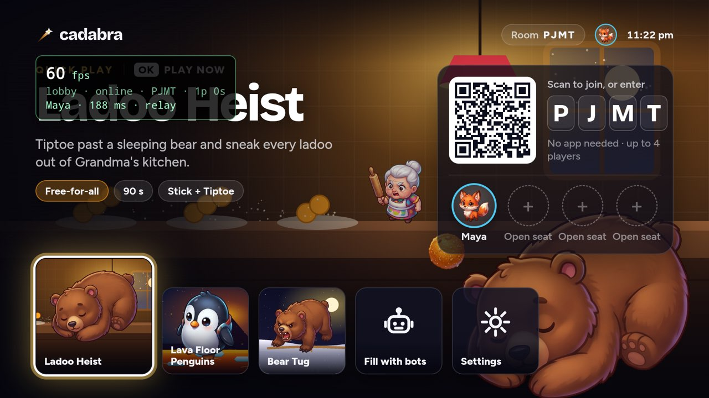
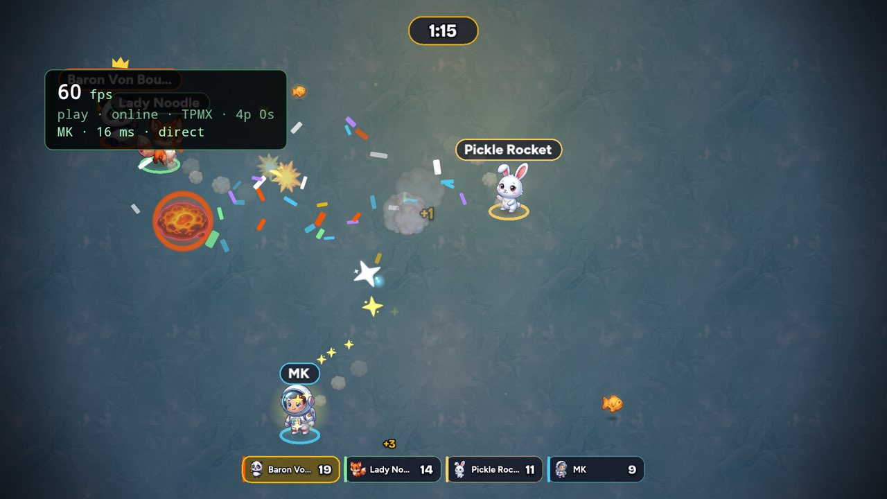
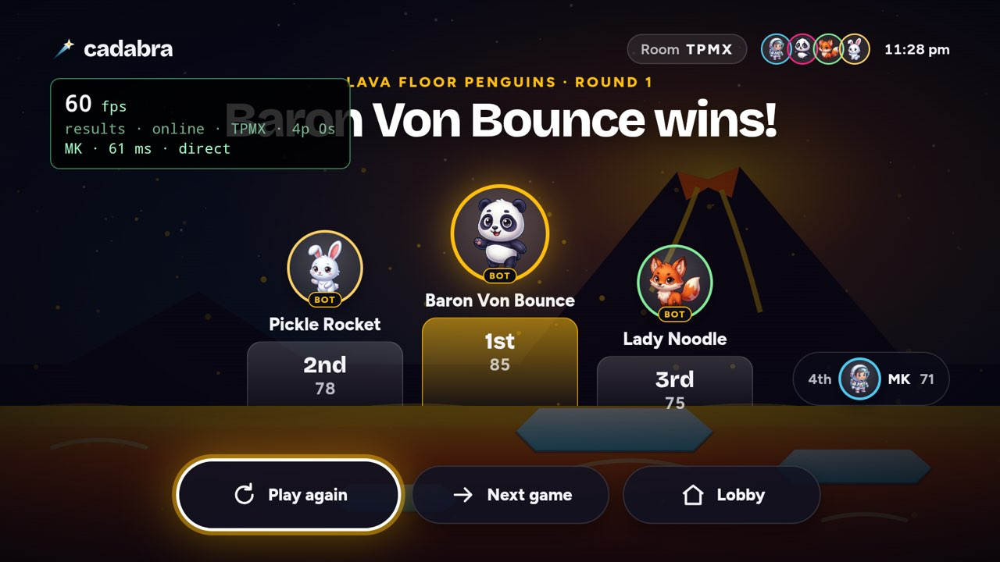
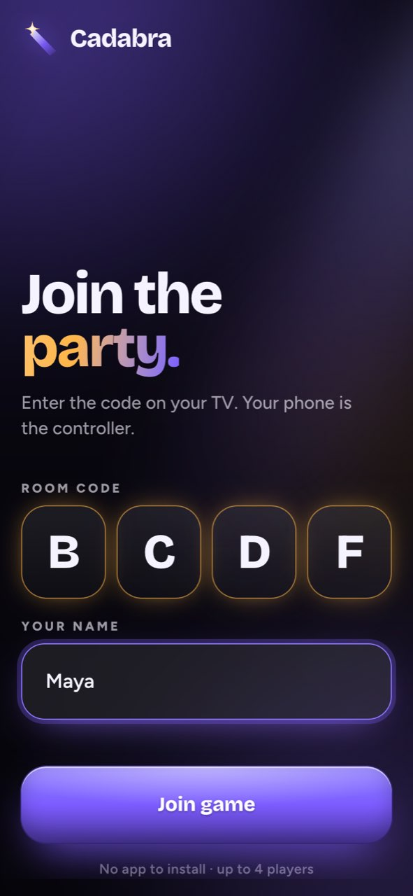
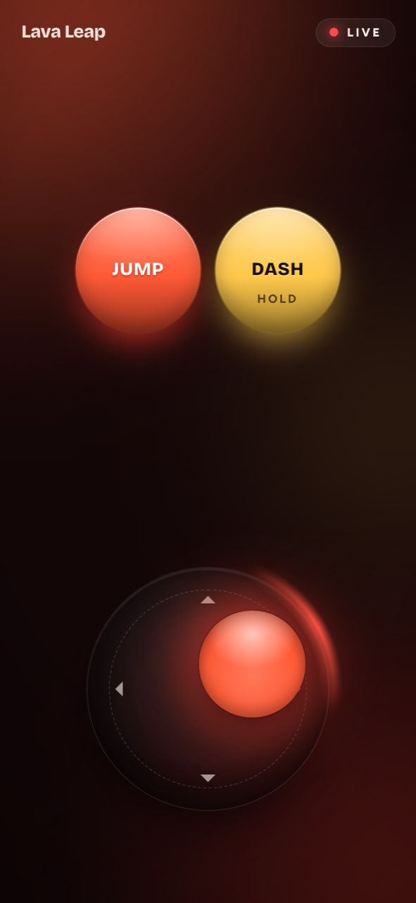
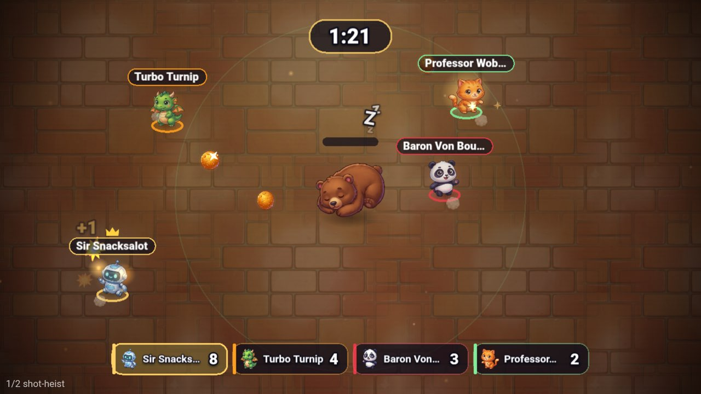
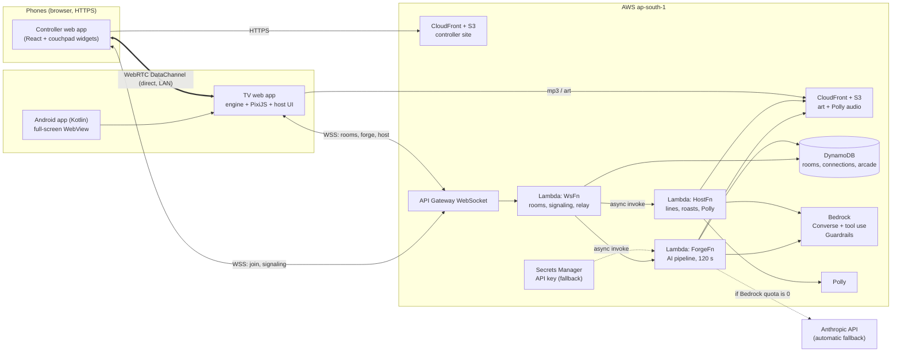

# Cadabra

### Say it. Play it.

**Cadabra is a Fire TV party game where the room invents the game, then plays it.** Everyone shouts ingredients from their phone ("a penguin", "lava", "grandma"), an AI game designer pitches three games, the room votes, and about 30 seconds later the winning game is running on the TV, with everyone's phone turned into the right controller. A voice host narrates and roasts you from the real events of the round.

"Cadabra" was Amazon's first name, back when the company was still a garage idea. Abracadabra: *I create as I speak.*

Built for the Amazon **Build, Ship, Shape** hackathon (Fire TV track, plus the AWS Builder and Open Source mini challenges).

| Lobby | In game | Results |
|---|---|---|
|  |  |  |

| Phone: join | Phone: play | Heist scene (device capture) |
|---|---|---|
|  |  |  |

> Demo GIF / video: `docs/media/demo.gif` (placeholder; the 3-minute video is linked from the Devpost submission, see [docs/SUBMISSION.md](docs/SUBMISSION.md)).

## Features

- **Phones are the controllers.** Scan the QR code (no install), pick a name and an avatar (selfie turned into a cartoon on the phone, or a premade character). Joystick, buttons, tilt, swipe, drawing and voting widgets appear depending on the game.
- **Idea Storm, then AI pitches.** Players type ingredients. A Claude-powered designer agent uses tool calling to emit three pitches (title, hook, game blocks) and, for the winner, a full validated game spec.
- **The Forge.** While the room votes, the other two designs are still being built speculatively; the winner is usually ready within a second or two of the vote. If the AI is slow or unavailable, a bot-playtested fallback game is reskinned with the room's ingredients so the game never waits.
- **A real game engine on a Fire TV Stick HD.** Deterministic simulation, 8 composable game blocks (sneak, collect, dodge, race, tug, arena-move, trivia, draw-judge), bots to fill empty seats, and a playtest gate that rejects unwinnable AI specs.
- **Cinematic 1080p rendering at 60 fps.** PixiJS (WebGL) in the Amazon WebView, with baked backgrounds, juice (screen shake, particles, popups, camera director), procedural SFX and music.
- **A host with a voice.** Amazon Polly speech (generative-engine voices chosen per host personality: cheeky, hype, calm) plus an AI-written roast built from the round's actual event log.
- **Family-safe by default.** Every player input and every generated line passes through Amazon Bedrock Guardrails.
- **Family Arcade.** Games the room did not pick are saved per household and can be replayed later.
- **Direct, low-latency input.** A WebRTC DataChannel straight from phone to TV over the home Wi-Fi (13 to 16 ms measured with a real phone), with an automatic WebSocket relay fallback. This transport is open sourced as [couchpad](https://github.com/MaanavKrishna/couchpad).

### Status at submission

| Area | State |
|---|---|
| Lobby, join, avatars, Idea Storm, pitch vote, Forge, tutorial, play, results, roast | Built and running on a real Fire TV Stick HD |
| Engine blocks, bots, playtest gate, fallback games | Built, tested |
| Arcade (backend + save/replay) | Backend built; TV shelf UI is the last piece, see the changelog in `docs/SUBMISSION.md` |
| Remix / tweak panel | Designed (see the spec); see `docs/SUBMISSION.md` for what shipped |
| Wild-mode block invention, share codes | Cut from this release |

## How it works



1. The TV creates a room over the WebSocket and shows a QR plus a 4-letter code. Phones open the controller from CloudFront, join, and exchange WebRTC offers through the backend; inputs then flow peer-to-peer. If the direct path fails, they relay through the same WebSocket.
2. The **TV is authoritative**: it runs the simulation; phones only send inputs and draw what the TV tells them to.
3. After the Idea Storm, the TV asks the backend for pitches. `ForgeFn` runs the Claude designer agent (tool calling against the game kit schema), validates specs, runs a headless bot playtest, screens everything with Guardrails, and streams progress back to the room.
4. During play, `HostFn` turns engine events into voiced lines (Polly mp3s are cached in S3 by text hash and served from CloudFront).

More detail, including data flows and the message catalogue, is in [docs/ARCHITECTURE.md](docs/ARCHITECTURE.md).

## AWS services used, and how

| Service | Used for |
|---|---|
| **Amazon Bedrock (Converse API, tool use)** | The game designer agent (pitches and full specs through tool calls), the fast host-line / roast / trivia model, and vision judging of drawings. Runs in ap-south-1 with ordered model fallback chains. |
| **Amazon Bedrock Guardrails** | A `cadabra-family-safe` guardrail (hate, insults, sexual, violence, misconduct, prompt attack, profanity word list) applied with `ApplyGuardrail` to player ingredients and to all generated text. Family-safe off relaxes to a client-side filter. |
| **Amazon Polly (generative, long-form, neural)** | The host voice. A voice per personality from the generative engine (called in us-east-1, where it is offered), with long-form, neural and standard Joanna as fallbacks; mp3s cached in S3 by hash in ap-south-1. |
| **AWS Lambda x3** | `WsFn` (rooms, WebRTC signaling, relay, throttling), `ForgeFn` (arm64, 3008 MB, 120 s AI pipeline), `HostFn` (host lines, roasts, AI judgements, Polly). |
| **Amazon API Gateway (WebSocket)** | Real-time room signaling, relay fallback and server push of Forge progress, with stage throttling. |
| **Amazon DynamoDB** | One on-demand table with TTL: rooms, connections, forge state, per-room rate counters, Family Arcade. Conditional writes make joins and votes atomic. |
| **Amazon S3** | Controller site, generated art, cached Polly audio (all private buckets, served only through CloudFront). |
| **Amazon CloudFront (x2)** | One distribution for the controller (immutable hashed assets, no-cache index), one for art/voice (CORS, prefix-guard CloudFront Function). |
| **AWS Secrets Manager** | Holds the API key for the automatic Anthropic API fallback. |
| **AWS CDK (TypeScript)** | The whole backend in one stack: `cdk deploy` stands up everything above. |

**An honest note on Claude and Bedrock.** The account created for this hackathon had every Anthropic model's applied Bedrock quota set to 0 (and Stability image models at 0 requests per minute, not adjustable), so Claude could not be invoked through Bedrock even after submitting the use-case form and filing quota increases. The code therefore treats Bedrock as the preferred provider and automatically falls back to the Anthropic API (key in Secrets Manager) when Bedrock returns access or throttling errors, and **switches back to Bedrock automatically as soon as it works**. Guardrails, Polly, hosting and everything else stay on AWS. Where no image model is available, art falls back to a default art pack plus palette tinting, and selfie avatars are cartoonised on the phone. Details are in [docs/FRICTION_LOG.md](docs/FRICTION_LOG.md) and [docs/FEEDBACK.md](docs/FEEDBACK.md).

## Setup

### Prerequisites

- Node.js 20+ and npm
- AWS account with credentials configured (`aws login` or a profile); region `ap-south-1`
- AWS CDK v2 (installed via the repo's dev dependencies; `npx cdk`)
- For the TV app: a Fire TV Stick with Developer Options and ADB debugging on, `adb` on your PATH, JDK 17 and the Android SDK (platform 34)
- Optional: an Anthropic API key, for the fallback provider when Bedrock model quotas are not available

### 1. Install

```bash
npm install
npm test            # ~480 tests, no AWS needed
```

### 2. Deploy the backend

```bash
# Optional but recommended on new AWS accounts: the Anthropic fallback key
aws secretsmanager create-secret --region ap-south-1 \
  --name cadabra/anthropic-api-key --secret-string "sk-ant-..."

bash apps/backend/deploy.sh      # bootstraps CDK if needed, then cdk deploy; prints outputs.json
```

The script retries without Lambda reserved concurrency on accounts whose unreserved-concurrency floor blocks it. Update the account id in the script if you use your own account. Outputs include the WebSocket URL, the controller CloudFront URL and the assets CDN URL.

### 3. Publish the phone controller

```bash
bash apps/controller/deploy.sh   # vite build -> S3 sync -> CloudFront invalidation
```

### 4. Install the TV app on a Fire TV

```bash
scripts/tv-install.sh <fire-tv-ip>   # builds the TV web app, bundles it into the Android app, adb install, launch
```

On the stick: Settings > My Fire TV > Developer Options > ADB Debugging (and Apps from Unknown Sources). The first connection shows an authorize prompt on screen.

For a quick look without a stick, run the TV app in a browser: `npm --prefix apps/tv run dev` and open `render-demo.html`.

## Repository layout

```
apps/
  android/       Kotlin Fire TV shell: leanback launcher, full-screen WebView, key mapping, volume pass-through
  tv/            TV web app (React UI, party state machine, host voice, Pixi game view)
  controller/    Phone web app (join, avatar/toon selfie, storm, vote, per-game controllers)
  backend/       AWS CDK stack + Lambdas (rooms/signaling, Forge AI pipeline, host voice, arcade)
packages/
  spec/          Zod contracts: game spec, wire protocol, fallback games
  engine/        Deterministic runtime, 8 blocks, bots, playtest gate
  render/        PixiJS game view, juice, camera director, procedural SFX and music
  couchpad/      Phone-as-controller transport + widgets (also published standalone)
scripts/         tv-install.sh, tv-record.sh, art pipeline
docs/            ARCHITECTURE, FEEDBACK, FRICTION_LOG, DEVICE_LIMITS, SUBMISSION, media
```

## Testing

```bash
npm test            # vitest across all workspaces: engine, spec, render, backend (mocked AWS), TV, controller, couchpad
npm run typecheck
```

Live smoke scripts (need AWS credentials and a deployed stack): `npx tsx apps/backend/scripts/smoke-forge.ts`, `smoke-host.ts`, `smoke-arcade.ts`, `smoke-bedrock.ts`, `smoke-art.ts`.

## Device performance (Fire TV Stick HD, AFTSS, Fire OS 7.7, 922 MB RAM)

Measured on the real stick with the on-device benchmark harness (full report in [docs/DEVICE_LIMITS.md](docs/DEVICE_LIMITS.md)):

- First render pass: 40 to 53 fps at 1280x720. After baking the static background into one cached texture (full-screen alpha layers cost about 2.5 ms each at 720p on the PowerVR GE8300), all game modes hold about **59.7 fps at 1280x720 with 4 players**, 59.9 with 8, and about **59 fps at native 1920x1080**.
- App memory 108 to 160 MB PSS, GPU memory 72 to 115 MB.
- Phone to TV input latency with a direct WebRTC DataChannel: **13 to 16 ms** on a home Wi-Fi.
- Amazon WebView is Chromium 138 with `devicePixelRatio = 2` and a 960x540 CSS viewport.

## Built during the hackathon window (Oct 20 to 24, 2026)

**Everything.** The default sprite art pack was generated with an image tool during the window and sliced by scripts in `scripts/art`. The repository was created at the start of the hackathon window; every package, the Android shell, the backend, the art pipeline and the docs were written during it. `couchpad` was extracted from this repo into its own MIT project at the end.

## Open source

- [`MaanavKrishna/couchpad`](https://github.com/MaanavKrishna/couchpad): the phone-as-controller library extracted from Cadabra (QR join, WebRTC DataChannel with relay fallback and chunking, keepalive, reliable queue, controller widgets, a reference signaling server).
- This repository: MIT.

## License

MIT, see [LICENSE](LICENSE). Copyright 2026 Maanav Krishna.
