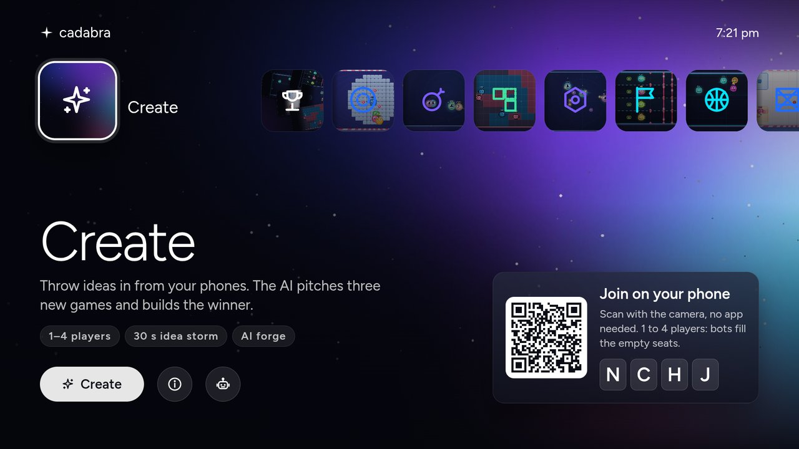
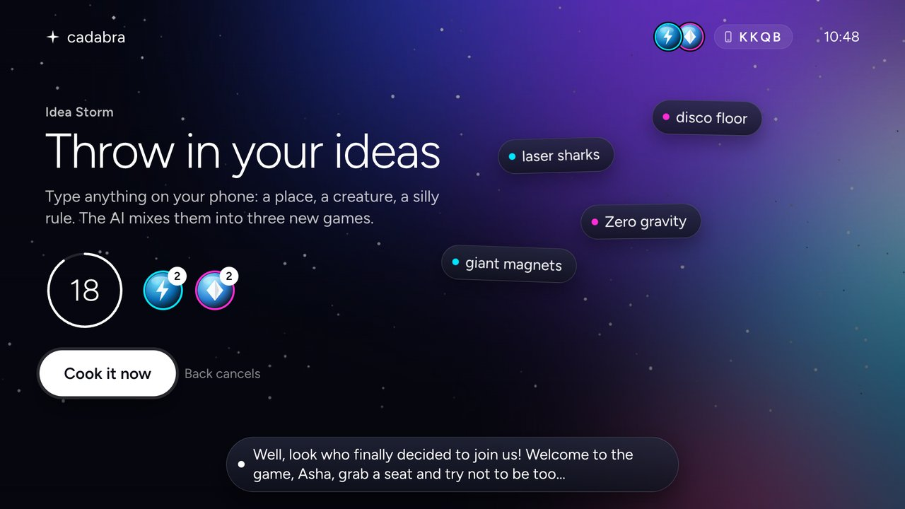
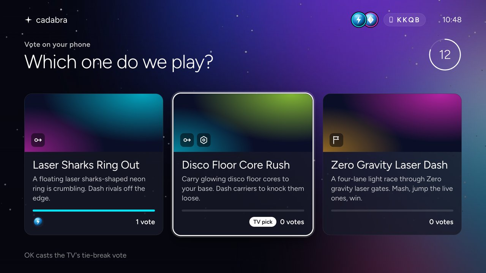
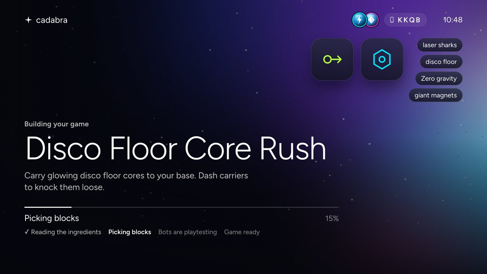
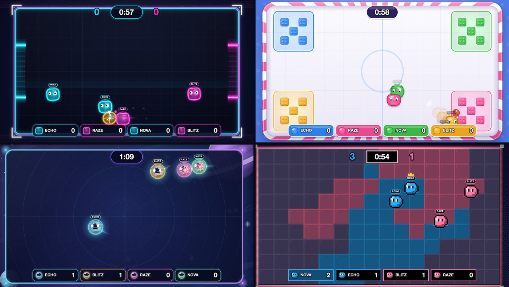
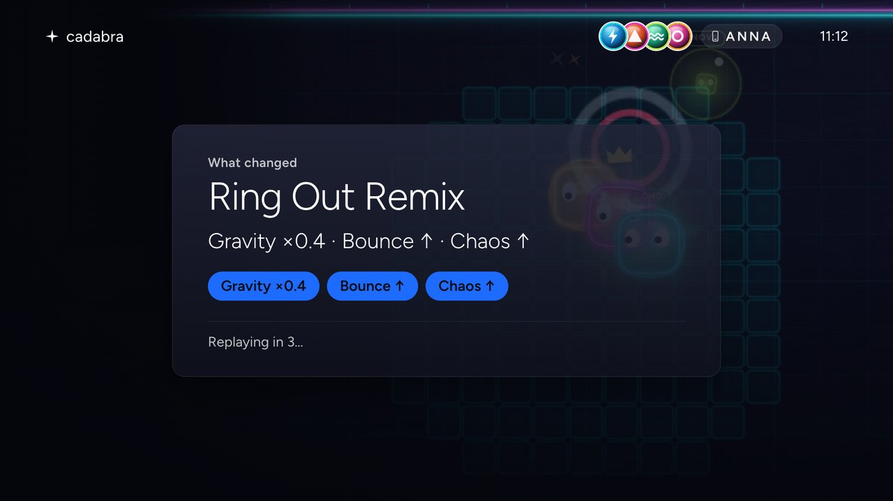
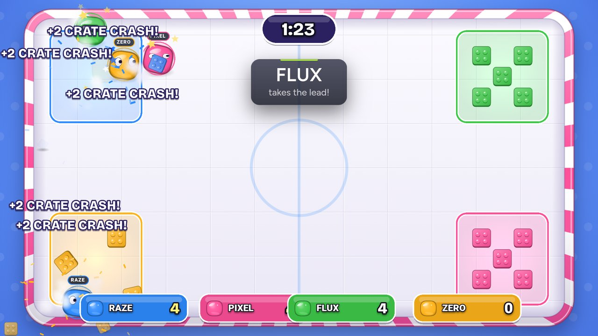
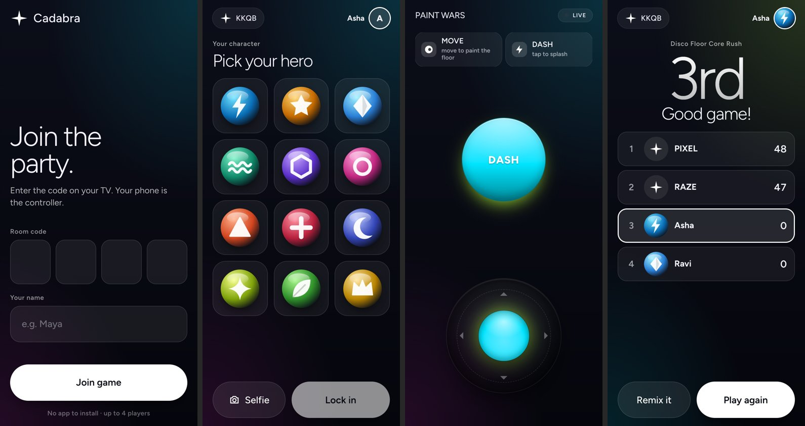
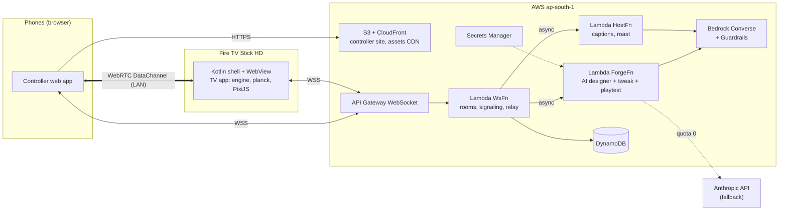

# Cadabra

### Say it. Play it.

**Cadabra is a Fire TV party game where the room invents the game and then plays it.** Everyone throws ideas in from their phone ("laser sharks", "disco floor", "zero gravity"). An AI game designer pitches three games, the room votes, and a few seconds later the winning game is running on the TV with real physics. Every phone becomes the controller. After the round, the room can tell the AI "low gravity" or "more chaos" and play the new version about 5 seconds later.

"Cadabra" was Amazon's first name, back when the company was still a garage idea. Abracadabra: *I create as I speak.*

Built for the Amazon **Build, Ship, Shape** hackathon: Fire TV track, plus the AWS Builder and Open Source mini challenges.



| Idea Storm | Three AI pitches, vote on phones | The AI builds it |
|---|---|---|
|  |  |  |

| Four looks, real physics | Tweak: "what changed" | Crate Crash on the stick |
|---|---|---|
|  |  |  |



## Features

- **A PS5-style TV home.** One row of tiles (Create, Party, the seven games, Arcade, Settings) over full-bleed hero stills baked from the real game renderer.
- **Seven built-in games**, each with real planck physics and one of four procedural looks:

  | Game | Look | What happens |
  |---|---|---|
  | Ring Out | toybox | Bumper sumo on a floating ring: dash rivals off the edge |
  | Overload | cosmos | Pass the unstable core before it blows; blasts throw everyone |
  | Paint Wars | retro | Paint the floor in your team colour |
  | Core Rush | cosmos | Carry cores home; dash carriers to knock them loose |
  | Neon Dash | neon | Four-lane light race through laser gates |
  | Rocket Ball | neon | 2v2 football with a big bouncy ball: power shots, comeback goal, multiball |
  | Crate Crash | toybox | Knock rivals' crates out of their zones; barrels explode |

- **Create.** A 30 s Idea Storm on the phones, then three AI pitches (about 6 s), a vote, and the AI designer builds the winner with tool calls and a bot playtest gate. The game is ready about 4 to 7 s after the vote.
- **Tweak and Remix.** After a round, phones tap chips (Low gravity, Faster, Bigger arena, Bouncier, More chaos, Harder for leader) or type a request. The AI patches the game spec in about 5 s, a "What changed" card shows the changes, and the game replays. Remix does the same from the Home row or the Arcade.
- **Party mode.** Four rounds of 45 s with standings between rounds.
- **Arcade.** Forged and remixed games are saved per household and can be replayed or remixed.
- **1 to 4 players.** Bots fill empty seats, so one phone (or none) is enough.
- **PS5-style trophies** (First Ring Out, Clutch Pass, Mega Core, ...) as toasts during play.
- **Orb or selfie avatars.** Twelve glossy glyph orbs, or a selfie styled on the phone.
- **Phones are the controllers, no app.** Scan a QR code. Inputs travel over a direct WebRTC DataChannel (13 to 16 ms measured) with a WebSocket relay fallback, using [couchpad](https://github.com/MaanavKrishna/couchpad), our open-source library.
- **Family-safe by default.** Every idea, pitch, tweak request and host caption is screened by Amazon Bedrock Guardrails.
- **About 59 fps on a Fire TV Stick HD**, in every built-in game.

There is no host voice: the host speaks in on-screen captions, and the round's roast is written from the real event log.

## Status at submission

| Area | State |
|---|---|
| Home, join, avatars, Idea Storm, pitches, vote, Forge, intro, play, results | Shipped, running on a Fire TV Stick HD |
| Seven built-in games, four looks, planck physics, bots, playtest gate | Shipped |
| Tweak (after a round) and Remix (Home and Arcade) | Shipped. AI patch, with deterministic chip presets as fallback |
| Party mode (4 x 45 s) | Shipped |
| Arcade (save, replay, remix) | Shipped |
| Trophies | Shipped |
| Host voice (Amazon Polly) | Built, then turned off by choice. Captions only |
| Generated sprite art | Off: image model quota is 0 on this account. Procedural looks instead |
| Wild-mode block invention, share codes | Cut |

## Quick start

### Play it on a Fire TV

1. On the stick: Settings > My Fire TV > Developer Options > ADB debugging (and Apps from Unknown Sources).
2. Sideload the APK and launch it:

   ```bash
   adb connect <fire-tv-ip>:5555
   adb install -r app-debug.apk        # or build it: scripts/tv-install.sh <fire-tv-ip>
   adb shell monkey -p com.maanavkrishna.cadabra -c android.intent.category.LEANBACK_LAUNCHER 1
   ```

3. Scan the QR code on the TV with your phone, or open the controller URL and type the 4-letter code.

### Run it locally (no Fire TV needed)

```bash
npm install
npm test                          # 633 tests, no AWS needed
npm --prefix apps/tv run dev      # TV app in a desktop browser
npm --prefix apps/controller run dev
```

Open `/render-demo.html?game=physics&look=toybox` on the TV dev server to see a physics scene; `look=neon|toybox|cosmos|retro` restyles any scene.

### Deploy your own backend

Prerequisites: Node.js 20+, an AWS account in `ap-south-1` (`aws login`), JDK 17 and the Android SDK 34 for the TV app.

```bash
# Optional on new accounts whose Bedrock quotas are 0: the Anthropic API fallback key
aws secretsmanager create-secret --region ap-south-1 \
  --name cadabra/anthropic-api-key --secret-string "sk-ant-..."

bash apps/backend/deploy.sh        # CDK bootstrap if needed, then cdk deploy
bash apps/controller/deploy.sh     # phone site: vite build, S3 sync, CloudFront invalidation
scripts/tv-install.sh <fire-tv-ip> # TV web app bundled into the Android shell, adb install
```

Change the account id in `apps/backend/deploy.sh` to your own. Live smoke tests: `npx tsx apps/backend/scripts/smoke-forge.ts` and `smoke-tweak.ts`.

## Architecture



- The **TV is authoritative.** It runs a deterministic, seeded engine and the planck physics; phones only send inputs.
- The **AI never writes code.** It composes a `GameSpec` from 9 tested blocks through tool calls (`get_block_schema`, `patch_spec`, `playtest_spec`, ...). A spec only reaches the TV after bots finish a full round with it.
- **Bedrock first, Anthropic API as fallback.** This account's Bedrock Claude quotas are 0, so calls fall back to the Anthropic API (Claude Sonnet 5.5 and Haiku 5.5) and switch back to Bedrock by themselves once it answers. Guardrails always run on AWS.

Details: [docs/ARCHITECTURE.md](docs/ARCHITECTURE.md).

### AWS services

| Service | Used for |
|---|---|
| Amazon Bedrock (Converse, tool use) | The AI designer, the tweak agent, pitches, host captions and the roast. Preferred provider, with ordered model chains |
| Amazon Bedrock Guardrails | `cadabra-family-safe`: screens ideas, typed tweaks, pitches and captions |
| AWS Lambda x3 | `WsFn` (rooms, signaling, relay), `ForgeFn` (arm64, 3008 MB: designer, tweak, playtests), `HostFn` (captions, roast) |
| Amazon API Gateway (WebSocket) | Rooms, WebRTC signaling, relay fallback, server push of forge progress |
| Amazon DynamoDB | One on-demand table with TTL: rooms, connections, forge locks, rate counters, Arcade |
| Amazon S3 + CloudFront | The phone controller site and the assets CDN (private buckets, OAC, prefix guard function) |
| AWS Secrets Manager | The Anthropic API fallback key |
| AWS CDK (TypeScript) | The whole backend as one stack |
| Amazon Polly | Built for a host voice, now unused (voice is off) |

## Repository layout

```
apps/
  android/      Kotlin Fire TV shell: leanback launcher, full-screen WebView, key mapping
  tv/           TV web app: PS5-style UI, party flow, tweak/remix, arcade, trophies
  controller/   Phone web app: join, avatars, storm, vote, tweak, per-game controls
  backend/      CDK stack + Lambdas: rooms, Forge AI designer, tweak, host captions, arcade
packages/
  spec/         Zod contracts: GameSpec, world physics, wire protocol, the 7 built-in games
  engine/       Deterministic runtime, 9 blocks, planck physics layer, bots, playtest gate
  render/       PixiJS game view, 4 looks, physics views, juice, procedural music and sfx
  couchpad/     Phone-as-controller transport + widgets (also its own repo)
scripts/        tv-install.sh, tv-record.sh
docs/           ARCHITECTURE, SUBMISSION, FRICTION_LOG, FEEDBACK, DEVICE_LIMITS, media
```

## Device performance (Fire TV Stick HD, Fire OS 7.7, 922 MB RAM)

The game renders at 1280x720, stretched to 1080p. In the real app, with 4 bots, each game in its own look:

| Ring Out | Overload | Paint Wars | Core Rush | Neon Dash | Rocket Ball | Crate Crash |
|---|---|---|---|---|---|---|
| 58.6 fps | 59.0 | 59.3 | 59.6 | 59.8 | 60.0 | 59.3 |

Crate Crash went from 45 to 59.3 fps after we stopped Pixi rebuilding its render instructions every frame and dropped the internal resolution from 1080p to 720p. Full numbers in [docs/DEVICE_LIMITS.md](docs/DEVICE_LIMITS.md).

## Built during the hackathon window (Oct 20 to 24, 2026)

All of it: every package, the Android shell, the backend, the art and the docs were written during the window. The repo was created at the start. `couchpad` was extracted from this repo into its own MIT project.

## Open source

- [MaanavKrishna/couchpad](https://github.com/MaanavKrishna/couchpad): phones as game controllers for TV and web games (QR join, WebRTC DataChannel with WebSocket relay fallback, chunking, keepalive, controller widgets, a reference signaling server).
- This repository: MIT.

## License

MIT, see [LICENSE](LICENSE). Copyright 2026 Maanav Krishna. The Figtree font is under the SIL Open Font License (`apps/tv/src/fonts/OFL.txt`).
