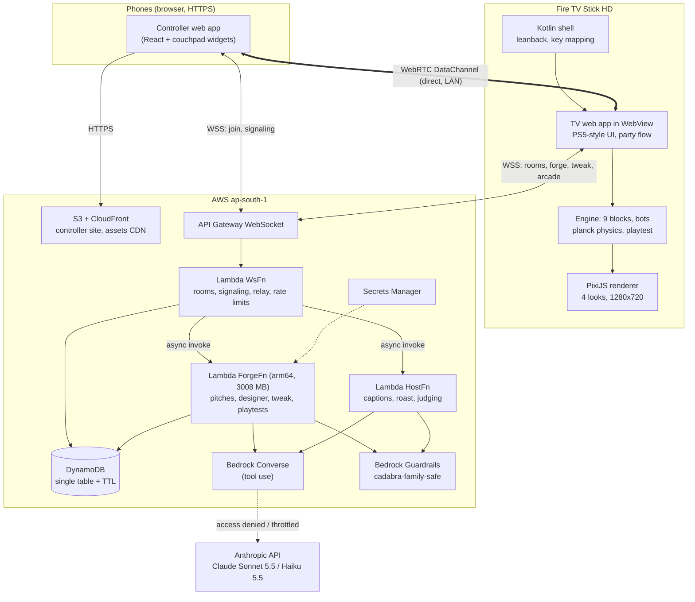
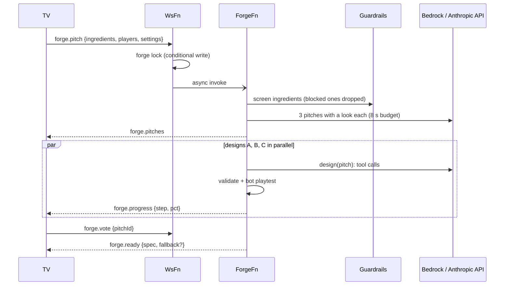
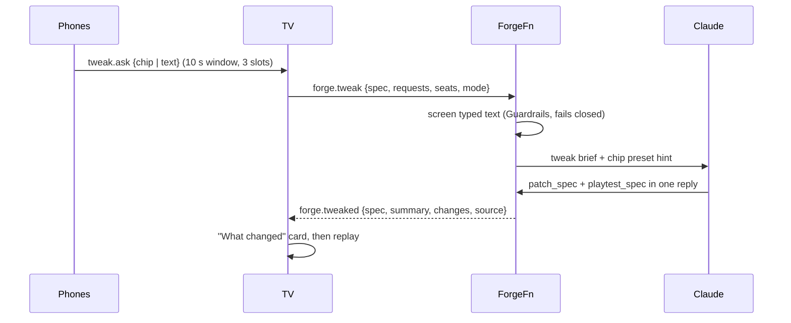
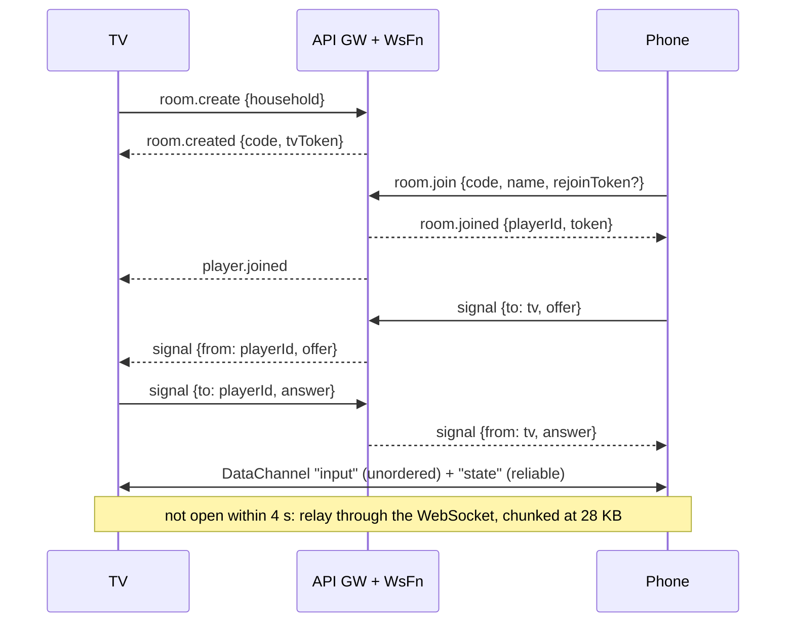

# Architecture

Cadabra has three runtime parts:

- the **TV app**, the authoritative game host, on a Fire TV Stick HD;
- the **phone controller**, a web page;
- a small **serverless backend** on AWS (ap-south-1).

Phones and the TV talk directly over WebRTC when they can, and through the backend when they cannot. The AI only ever produces data (a `GameSpec`), never code, and every spec is played by bots before a human sees it.

## Components

| Component | Path | Responsibility |
|---|---|---|
| Fire TV shell | `apps/android` | Leanback launcher and banner, keeps the screen on, full-screen WebView that serves the bundled TV app from `https://appassets.androidplatform.net` (a secure context, so WebRTC and WebGL work). Maps remote keys into JS, passes volume and mute through, and defines the Back contract (`exit` / `handled`). |
| TV web app | `apps/tv` | PS5-style home, the Create flow (storm, pitches, vote, forge), intro, play, results, Tweak and Remix, Party, Arcade, Settings, trophies, D-pad focus, UI sounds, and the `CouchHost` that talks to phones. |
| Engine | `packages/engine` | Deterministic, seeded runtime. A `GameSpec` composes **blocks**, with a planck physics layer, bots, an event log, and the playtest gate. |
| Spec | `packages/spec` | Zod schemas shared by every side: `GameSpec` (including `world.physics`, `world.props`, `theme.look`), the wire protocol, phone screens, tweak chips, and the 7 built-in games. |
| Render | `packages/render` | PixiJS game view: 4 looks, physics prop views, HUD, popups, camera director, particles with an adaptive budget, procedural music and sfx per look. |
| Couchpad | `packages/couchpad` | Phone-as-controller transport and widgets, also published as [MaanavKrishna/couchpad](https://github.com/MaanavKrishna/couchpad). |
| Controller | `apps/controller` | Phone app: join, orb or selfie avatar, Idea Storm, vote, tweak chips and text, per-game controls built from the spec's widget list. |
| Backend | `apps/backend` | One CDK stack and the Lambda handlers below. |

## The AI designer (tool calling)

The designer runs in `ForgeFn` (`apps/backend/src/ai/designer.ts`, `tools.ts`). It gets a system prompt that lists the block kit, the looks, the physics world schema (generated from the zod `.describe()` text) and fun rules: a clear goal, risk and reward, a comeback, physical comedy. The system prompt and tools are shared by design and tweak jobs, so they hit the same prompt cache.

Tools:

| Tool | What it does |
|---|---|
| `list_blocks` | The kit: block id, summary, controls, arena kinds |
| `get_block_schema` | One block's params as JSON Schema with defaults, plus the controller widgets it needs |
| `validate_spec` | Schema check, returns `{ok, errors}` |
| `playtest_spec` | Validate, then play a full round with 4 bots (skills 0.4 to 0.9). Returns `{ok, reasons, stats}`, and the reasons say exactly what to fix |
| `patch_spec` | RFC 6902 JSON Patch on the latest spec. Tweak jobs also pass a `summary` and `changes` tags |
| `submit_spec` | Kept for compatibility. A passing playtest of the latest spec already counts as the submission |

Because a passing `playtest_spec` is the submission, a typical design takes **one model reply**. Measured on the live backend: pitches in about 6 s (Haiku 5.5, 8 s budget, else fallback pitches), and the winner ready about 4 to 7 s after the vote.

### The Forge flow

- All three designs start as soon as the pitches go out, so the winner is usually ready a few seconds after the vote.
- The winner has 25 s after the vote. If it is not ready by then, a built-in game is reskinned from the pitch (title, hook, look, palette) and sent as `forge.ready {fallback: true}`. The room never waits on the AI.
- Losing pitches that finish are saved to the household Arcade.
- Everything stops at the Lambda deadline minus a margin. If the TV reconnects mid-forge, pitches and ready messages are replayed.

## Deterministic engine and the bot playtest gate

- The runtime is seeded and deterministic, so a playtest is cheap and reproducible. A full 4-bot round runs in milliseconds on Lambda.
- **9 blocks:** sneak, collect, dodge, race, tug, arena-move (with ring-out, overload, paint, core-rush and crate modes), trivia, draw-judge and ball-sport.
- `playtest()` (`packages/engine/src/playtest.ts`) validates the spec and then plays a full round with bots. It rejects the spec if:
  - the schema, block params, arena kind or controller widgets are wrong (for example a duplicate widget id, or a block without the widget it needs);
  - the round throws, is too heavy to simulate, or puts too many entities on screen;
  - fewer than 2 bots scored (the message names the blocks that penalised or eliminated them);
  - a timed round ended before most of its duration.
- Each reason says what to change, so the model can fix the spec in the next tool call.
- The same gate checks every **Tweak** result and every local chip preset, at the real seat count.
- Balance over 40 bot rounds per built-in game: 2.6 to 6.8 lead changes per round. All seven games pass the strict playtest at 2, 3 and 4 seats.

## Physics

- `packages/engine/src/physics.ts` wraps **planck** (Box2D in JS, MIT) at 32 px per metre.
- Blocks still write `x/y/vx/vy`. The layer diffs each entity against its last read-back, so block code and physics coexist.
- `spec.world.physics` exposes gravity, restitution, friction, damping, player mass, spin, knockback, walls, bumper kick and barrel power. `spec.world.props` adds balls, crates, bumpers and barrels (at most 40 bodies).
- Generic rules: impacts set `hitAt` and `impulse` for the renderer, touch credit chains through props, bumpers kick, barrels detonate into physics blasts, props respawn.
- Cost: 4 players and 40 bodies with bot AI take 0.11 ms per step on a laptop, and about 1.5 to 3 ms per frame on the stick.

## Looks

A spec's `theme.look` picks one of four fully procedural looks (`packages/render/src/looks.ts`, `lookArt.ts`, `lookScenes.ts`). The AI picks a look per pitch.

| Look | Arena | Sprites | Music |
|---|---|---|---|
| neon | dark grid, additive glow | neon bodies with eyes | synthwave |
| toybox | polka-dot table, candy kerb | glossy vinyl, toy-brick crates, pinball bumpers | bouncy major key with swing |
| cosmos | nebula, starfield, glass deck | astronaut orbs, crystals, moon ball | ambient pad and plucks |
| retro | 1/8-resolution pixel art, scanlines | hand-typed 16 px sprites | chiptune |

Each look bakes its arena into one opaque layer, because full-screen alpha layers are what the stick's GPU cannot afford.

## The Tweak loop

- Chips: Low gravity, Faster, Bigger arena, Bouncier, More chaos, Harder for leader. Typed text is up to 80 characters.
- The first passing patched spec wins. One repair reply is allowed. Live: p50 5.7 s, p90 8.5 s over 16 runs.
- If the AI misses its deadline (about 12 s), deterministic chip presets run instead, at full strength and then half strength, each playtest-checked. Hard cap: 15 s.
- The TV has its own copy of the presets for offline play, backend errors, or no answer in 16.5 s.
- A changed spec gets a new id with `origin.parentId`. Remix uses the same flow from the Home row or the Arcade and saves the result as a new Arcade entry.

## Bedrock first, Anthropic API as fallback

`apps/backend/src/ai/bedrock.ts` exposes one `converse()` for the roles `designer` (Sonnet 5.5) and `fast` (Haiku 5.5). Each role has an ordered chain of model ids and inference profiles (`anthropic.`, `in.`, `global.`).

- `ValidationException`, `AccessDeniedException` and `ResourceNotFoundException` mean "this id is unusable here, try the next one".
- If the whole chain fails with an access, not-found or throttling error, `anthropic.ts` answers the same Converse-shaped request through the Anthropic Messages API, translating tool use both ways. The key is in Secrets Manager (`cadabra/anthropic-api-key`).
- The choice is remembered for 2 minutes after throttling and 10 minutes after access errors. After that Bedrock is tried first again, so the system moves back to Bedrock by itself once quotas arrive.
- The Bedrock client uses `maxAttempts: 1`: a throttled probe took 1.5 s with SDK retries and 0.17 s without, which the pitch and tweak budgets cannot afford.
- On this account every Bedrock Claude quota is 0, so the live game runs on the fallback. See [FRICTION_LOG.md](FRICTION_LOG.md).

## Guardrails

- One guardrail, `cadabra-family-safe` (hate, insults, sexual, violence, misconduct, prompt attack, profanity word list), deployed by CDK and called with `ApplyGuardrail`.
- It screens Idea Storm ingredients, typed tweak requests, pitches, tweak summaries and change tags, host captions and the roast.
- It is independent of the model provider, so it runs on AWS on both the Bedrock and the fallback path.
- With family-safe on, any intervention blocks and screening fails closed. With family-safe off, the same guardrail is used, but only HATE and SEXUAL at HIGH confidence block (a filter on the assessment).
- Blocked ideas are dropped and the player's phone shows a "blocked" screen.

## Join, WebRTC, relay

- Phones may only address `tv`. The server stamps `from`.
- A TV restart resumes the room with `room.resume {code, tvToken}`. A phone refresh keeps its seat with the rejoin token.
- Inputs carry a sender timestamp and stale frames are dropped. Held inputs are resent every 100 ms, and a button release is sent twice.

## Message catalogue

Authoritative definitions: `packages/spec/src/protocol.ts`. All frames are JSON with a string `t`.

| Direction | Messages |
|---|---|
| TV/phone to backend | `room.create`, `room.join`, `room.resume`, `signal`, `relay`, `ping`, `forge.pitch`, `forge.vote`, `forge.tweak`, `host.say`, `host.roast`, `judge.request`, `arcade.list`, `arcade.save`, `arcade.play`, `arcade.delete`, `arcade.played` |
| Backend to TV/phone | `room.created`, `room.resumed`, `room.joined`, `player.joined`, `player.left`, `tv.left`, `tv.back`, `signal`, `relay`, `pong`, `error {code}`, `screen`, `forge.pitches`, `forge.progress`, `forge.ready`, `forge.art`, `forge.tweakProgress`, `forge.tweaked`, `host.audio`, `host.roasted`, `judge.result`, `arcade.items`, `arcade.game` |
| Phone and TV peer (DataChannel or inside `relay`) | `input {frame}`, `screen {name, data}`, `ping`, `pong`, `~chunk` envelopes |

Phone screens: `join`, `avatar`, `storm`, `vote`, `warmup`, `play`, `results`, `tweak`, `wait`, `blocked`.

`host.audio` still carries the caption text. Voice is off (`voice: false`), so no audio URL is sent and Polly is not called.

## Rendering budget on the stick

- The Stick HD's PowerVR GE8300 is fill-rate bound. Each full-screen alpha layer costs about 2.5 ms at 720p, and any full-stage filter halves the frame rate. The TV app uses no `filter` or `backdrop-filter` anywhere.
- Pixi rebuilt its instruction list every frame because the y-sort wrote `zIndex` on every moving body and a sweep flipped `visible`. That was about 25% of the frame. Now depth is only re-sorted when bodies are out of order by more than 6 px, and each dynamic layer is its own render group.
- The game renders internally at **1280x720**, stretched to 1080p (text is rasterised at 1.4x). Crate Crash went from 42 fps at 1920 to 58.7 at 1280 with the same code.
- Shaders and the GOAL! banners are compiled behind the intro card, so the first goal does not hitch.
- Result in the real app, each game in its own look: 58.6 to 60.0 fps. See [DEVICE_LIMITS.md](DEVICE_LIMITS.md).

## Security and privacy

- No AWS credentials on devices. Rooms are protected by random codes, a TV token and per-player rejoin tokens.
- All inbound frames are Zod-validated and size-bounded (128 KB, ideas and tweaks 80 characters).
- Guardrails screen inputs and outputs. Player names are stripped of prompt-structure characters, and untrusted data is wrapped in tagged blocks with an "untrusted data" rule in the prompts.
- Per-room caps (tweaks, roasts, captions, judging) are enforced with DynamoDB counters.
- A selfie is styled on the phone and only goes to the TV: other phones get a `selfie:<playerId>` reference, never the image.
- Buckets are private (OAC). A CloudFront Function limits the public asset paths.
