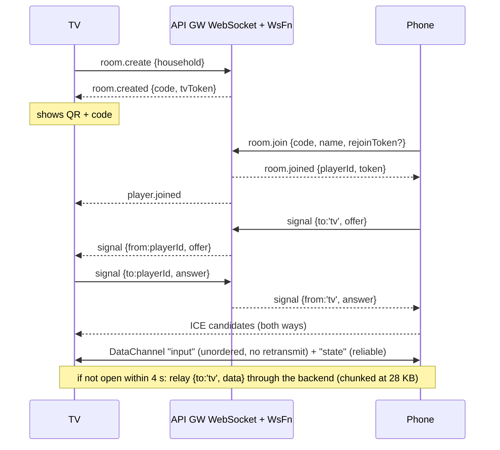
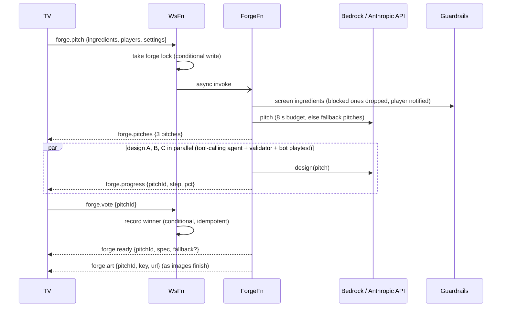

# Architecture

Cadabra has three runtime parts: the **TV app** (authoritative game host, on a Fire TV Stick), the **phone controller** (a web page), and a small **serverless backend** on AWS. Phones and the TV talk directly over WebRTC when they can, and through the backend when they cannot.

```
 Phones (browser)          AWS (ap-south-1)                              Fire TV Stick HD
 ----------------          ----------------                              ----------------
 Controller web app -HTTPS- CloudFront + S3 (controller site)             Android app (Kotlin)
        |                   CloudFront + S3 (art + voice mp3)               \- WebView: TV web app
        +--WSS signaling--> API Gateway WebSocket <--WSS-- (rooms, forge)        engine + UI + PixiJS
        |                    +- Lambda WsFn   (rooms, signaling, relay)
        |                    +- Lambda ForgeFn (AI pipeline, 120 s)
        |                    +- Lambda HostFn  (host lines, roast, judge, Polly)
        |                    +- DynamoDB (rooms, connections, forge, arcade)
        +===== WebRTC DataChannel, direct over home Wi-Fi ==========> TV
              (fallback: relay through API Gateway WebSocket)
```

## Components

| Component | Path | Responsibility |
|---|---|---|
| Fire TV shell | `apps/android` | Leanback launcher + banner, keeps the screen on, hosts a full-screen WebView serving the bundled TV app from `https://appassets.androidplatform.net` via `WebViewAssetLoader` (a secure context, so WebRTC and WebGL work). Maps remote keys into JS; lets volume/mute through to the system; defines the Back contract (`exit`/`handled`). |
| TV web app | `apps/tv` | Party state machine (lobby, storm, pitches, forge, tutorial, play, results), D-pad focus, host voice playback, settings, and the `CouchHost` that talks to phones. Runs `GameRuntime` and the Pixi `GameView`. |
| Engine | `packages/engine` | Deterministic, seeded runtime. A `GameSpec` composes **blocks** (sneak, collect, dodge, race, tug, arena-move, trivia, draw-judge). Also bots, event log (the roast's source), score/lead-change events, and the **playtest gate** that rejects specs bots cannot finish or win fairly. |
| Spec | `packages/spec` | Zod schemas shared by every side: `GameSpec`, controls, the wire protocol, screens, and the three hand-tuned fallback games (Ladoo Heist, Lava Penguins, Bear Tug). |
| Render | `packages/render` | PixiJS scene: baked static background, entities, HUD, popups, camera director, particles/juice with an adaptive FX budget, procedural SFX and music. |
| Couchpad | `packages/couchpad` | Phone-as-controller transport and widgets (published standalone as `MaanavKrishna/couchpad`). |
| Controller | `apps/controller` | Phone React app: join, toon selfie avatar (on-device posterize + outline), idea storm, vote, per-game controllers built from the spec's widget list. |
| Backend | `apps/backend` | CDK stack + handlers. See below. |

## Backend

One CDK stack (`apps/backend/infra/stack.ts`):

- **API Gateway WebSocket** (stage `prod`, throttle 300 rps / 600 burst) routes every frame to `WsFn`.
- **`WsFn`** (256 MB, 10 s): validates each frame against `ClientToBackendSchema`, keeps rooms and connections in **DynamoDB** with conditional writes (join, vote, token, player cap), forwards `signal` and `relay`, rate-limits, and invokes the other two Lambdas asynchronously.
- **`ForgeFn`** (arm64, 3008 MB, 120 s): the AI pipeline, below.
- **`HostFn`** (1024 MB, 30 s): writes and voices host lines, roasts, trivia and drawing judgements; mp3s cached in S3.
- **DynamoDB**: single table `pk/sk`, on-demand, TTL attribute. Items: room META, `CONN#` records, players, per-room counters, arcade games per household.
- **S3 + CloudFront** x2: the controller site (hashed assets cached for a year, `index.html` always revalidated) and an assets bucket for art and voice behind a CloudFront Function that only allows `/voice/*` and `/art/*`.
- **Bedrock Guardrails** (`cadabra-family-safe`), **Polly**, and **Secrets Manager** (fallback API key) are called by the AI Lambdas; no AWS credentials ever reach the TV or phones.

### AI provider layer

`apps/backend/src/ai/bedrock.ts` exposes one `converse()` for text roles `designer` (largest model) and `fast` (small model). Each role has an ordered chain of model ids / inference profiles; `ValidationException`, `AccessDeniedException` and `ResourceNotFoundException` mean "this id is unusable here, try the next". If the Bedrock chain fails with an access, not-found or throttling error and an API key exists in Secrets Manager (`cadabra/anthropic-api-key`), `anthropic.ts` answers the same Converse-shaped request through the Anthropic Messages API (translating tool use both ways) and the choice is remembered for a short window (2 minutes after throttling, 10 minutes after access errors). When the window ends Bedrock is tried first again, so the system returns to Bedrock by itself once quotas arrive. A failing fallback never pins the system: the next call tries Bedrock. Guardrails run on both paths because screening is a separate `ApplyGuardrail` call.

## Data flows

### 1. Join, WebRTC, relay



- Phones may only address `tv`; the TV may address any player. The server stamps `from`.
- TV restart: `room.resume {code, tvToken}` returns the live player list; phones get `tv.left` / `tv.back` and re-offer WebRTC.
- Phone refresh: the per-room rejoin token returns the same seat.
- Input reliability: continuous frames carry a sender timestamp and stale ones are dropped; held inputs are resent every 100 ms; a button release is sent twice; blur/hide sends a zeroed frame.

### 2. The Forge: pitch, speculative design, vote, ready



- Pitches go out first; designs for all three start only after, so a slow design never delays the vote.
- The winner's deadline is vote time + 25 s; if its design is not done, a bot-playtested fallback game is reskinned from the pitch (title, hook, palette, sprites) and sent as `forge.ready {fallback:true}`. A pitch that fails before the vote gets its fallback ready immediately.
- Losing pitches' finished specs are saved to the household Arcade (`onLoserReady`).
- Everything is bounded by a hard stop (Lambda time remaining minus 4 s). If the TV reconnects mid-forge, pitches and ready messages are replayed.

### 3. Host voice and judge

- `host.say {kind, ctx, personality, familySafe, voice}` produces a short line (AI-written from engine events, or fixed text), screens it, synthesizes it with Polly (generative voice per personality, called in us-east-1), stores `voice/<hash>.mp3` and answers `host.audio {text, url?}`. No `url` means voice failed or is off: the TV shows the caption.
- `host.roast {events, players, title, hook}` summarises the round's real event log into lines and `host.roasted {lines, urls}`.
- `judge.request {kind:'draw'|'trivia-gen', payload}` runs AI judgement for the engine (a vision call over phones' drawings, or generated trivia) and answers `judge.result`. The engine's `pendingJudgements()` / `resolveJudgement()` API times out and falls back to a deterministic result, so a slow model never stalls a round.
- Per-room lifetime caps (roast, judge, say) are enforced with a DynamoDB counter and answered with `room.rateLimited`.

### 4. Arcade

`arcade.list | save | play | delete | played`, keyed by a per-household id the TV generates once. Items stay small (art is https URLs only, never data URLs, because API Gateway caps server-to-client messages at 128 KB); at most 50 per household, evicting oldest unplayed first. The TV shelf screen is browsed with the D-pad.

## Message catalogue

Authoritative definitions: `packages/spec/src/protocol.ts`. All frames are JSON with a string `t`.

| Direction | Messages |
|---|---|
| TV/phone to backend | `room.create`, `room.join`, `room.resume`, `signal`, `relay`, `ping`, `forge.pitch`, `forge.vote`, `host.say`, `host.roast`, `judge.request`, `arcade.list`, `arcade.save`, `arcade.play`, `arcade.delete`, `arcade.played` |
| Backend to TV/phone | `room.created`, `room.resumed`, `room.joined`, `player.joined`, `player.left`, `tv.left`, `tv.back`, `signal`, `relay`, `pong`, `error {code}`, `screen`, `forge.pitches`, `forge.progress`, `forge.ready`, `forge.art`, `host.audio`, `host.roasted`, `judge.result`, `arcade.items`, `arcade.game` |
| Phone <-> TV peer (DataChannel or inside `relay`) | `input {frame}`, `screen {name, data}`, `ping`, `pong`; `~chunk` envelopes for oversized relay payloads |
| Error codes | `room.notFound`, `room.full`, `room.badRequest`, `room.notInRoom`, `room.targetGone`, `room.badToken`, `room.rateLimited`, `forge.busy`, `forge.badVote` |

Phone screens (`screen.name`): `join`, `avatar`, `storm`, `vote`, `warmup`, `play`, `results`, `remix`, `tweak`, `wait`, `blocked`.

## Game spec and engine

A `GameSpec` (Zod) holds: title and hook, palette, arena, a list of block instances with parameters, win condition (`firstTo`, timed, last standing), controller widgets per role, host lines, and optional art references. The designer agent never writes free-form code: it fills the schema through tools, and the **validator** plus a **headless bot playtest** (seeded runs) gate the result for completeness, winnability and fairness (e.g. duplicate widget ids fail). The runtime is deterministic per seed, so playtests are cheap and reproducible. Per-frame state goes to `GameView`, which uses a snapshot-based renderer with interpolation; engine events (`score`, `lead-change`, block-specific events) drive both juice and the roast.

## Rendering budget on the stick

The Fire TV Stick HD GPU is fill-rate bound. Static background layers (floor, light pool, vignette, glow) are baked into one cached texture regenerated only when the theme or arena changes, which moved the game view from 40 to 53 fps to a steady ~60. Particle count is capped (250) with an adaptive `FxBudget`. See [DEVICE_LIMITS.md](DEVICE_LIMITS.md) for measurements.

## Security and privacy

- No AWS credentials on devices. Rooms are protected by random codes, a TV token, and per-player rejoin tokens; the server stamps `from` and enforces who may address whom.
- All inbound frames are Zod-validated and size-bounded (128 KB inbound cap, drawings downscaled to about 256 px on the phone, text ingredients 80 chars).
- Guardrails screen inputs and outputs; player names are stripped of control and prompt-structure characters, and untrusted data is wrapped in tagged blocks with an "untrusted data" rule in prompts.
- Selfies never leave the phone: the cartoon avatar is rendered on-device and only a premade key or `selfie:<playerId>` reference is sent.
- CloudFront Function limits public bucket paths; buckets are private (OAC).
